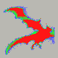
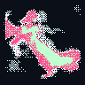
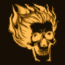
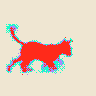
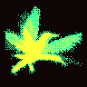
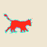

# PixelAnim

Generador **local** de animaciones pixel-art tramadas (estilo 1-bit retro) con IA.
Texto, imagen, fotos de internet o vídeo → sprite animado → **GIF · CSS `box-shadow` · sprite sheet · fondo de pantalla HTML**.
Todo corre en tu PC: sin cuentas, sin pagos, sin subir nada.

*Local AI pixel-art animation generator (dithered 1-bit style). Text, image, web references or video → animated sprite exported as GIF, pure-CSS box-shadow animation, sprite sheet and HTML wallpaper. Windows, runs fully offline after setup.*

| | | |
|:-:|:-:|:-:|
|  |  |  |
|  |  |  |

## Empezar (Windows)

1. Descarga el repositorio: **Code → Download ZIP** y descomprímelo en una ruta sin paréntesis (p. ej. `D:\PixelAnim`).
2. Doble clic en **`INICIAR.bat`**.
   - La primera vez instala dentro de la carpeta Python portable, PyTorch (con CUDA si hay NVIDIA) y las librerías. Tarda entre 10 y 20 minutos.
   - Luego comprueba la instalación y abre la interfaz en el navegador.
3. Opcional, recomendado: instala [Ollama](https://ollama.com/download/windows) y ejecuta **`MODELOS_OLLAMA.bat`** para que el chat entienda español libre.

Guía completa para usuarios: **[LEEME.txt](LEEME.txt)** · Detalles técnicos: **[docs/TECNICO.md](docs/TECNICO.md)**

**Requisitos:**
- Windows 10/11 de 64 bits.
- GPU NVIDIA de 6 GB o más (recomendado; en CPU funciona, pero lento).
- Unos 15 GB libres.

## Qué hace

- **Chat**: «un cuervo volando en rojo», «busca en internet un zorro corriendo», adjuntar una imagen… y luego «más grande», «en verde», «otra versión».
- **Texto → animación**: AnimateDiff-Lightning (4 pasos) sobre Stable Diffusion 1.5 (DreamShaper 8).
- **Imagen → animación**: tu imagen recibe un movimiento base (flotar, respirar, balanceo, viento o aleteo) y la IA la redibuja de vídeo a vídeo.
- **Agente buscador**:
  - Busca referencias en DuckDuckGo, Bing, Openverse y Wikimedia Commons, también filtrando por Pinterest, DeviantArt, Reddit y ArtStation.
  - Las ordena con CLIP local, recorta el sujeto con rembg y anima las mejores.
- **Pixelizador propio**:
  - Encuadre automático y limpieza de motas.
  - Niveles globales sin parpadeo y bucle sin corte.
  - Tramado Bayer 8×8 con grano que cambia en cada fotograma.
  - 7 paletas y de 1 a 5 tonos.
- **Robusto**:
  - Una generación a la vez.
  - Si la GPU se queda sin memoria, pasa a usar la RAM y reintenta.
  - Los errores se muestran en la interfaz.
  - La búsqueda corre en un proceso aislado.

## Uso por consola

```
GENERAR.bat "murciélago volando" --res 96 --paleta gris --semillas 1 2 3
GENERAR.bat "búho volando" --web --variantes 3
python\python.exe pixelanim.py imagen foto.png --movimiento aleteo --fuerza 0.6
python\python.exe pixelanim.py video clip.mp4 --res 128 --paleta fosforo
python\python.exe pixelanim.py probar --ia
```

## Licencias

- Código: [MIT](LICENSE).
- Los modelos se descargan de Hugging Face y tienen sus propias licencias:
  - DreamShaper 8 y AnimateDiff-Lightning: CreativeML OpenRAIL-M.
  - CLIP: MIT.
  - U²-Net/rembg: Apache-2.0/MIT.
- Las imágenes que encuentra el buscador pertenecen a sus autores. Las de Openverse y Commons llevan su licencia en `referencias.json`.
